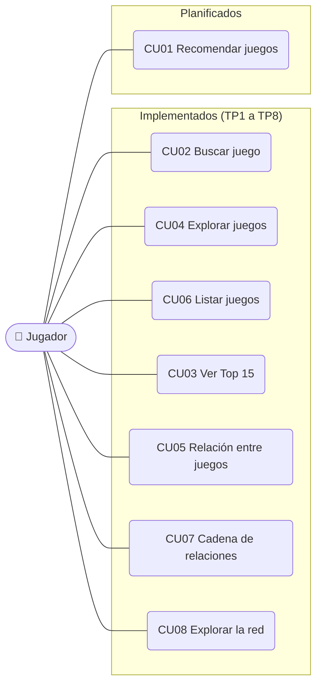

# Casos de uso — Pixperience

## Diagrama

## CU01 — Recomendar juegos (RF01)
- **Actor:** Jugador
- **Precondición:** el catálogo está cargado.
- **Flujo principal:**
  1. El jugador selecciona "Recomendar juegos".
  2. El sistema pide un juego que le guste.
  3. El jugador ingresa un título.
  4. El sistema pide otro juego, o dejar la respuesta vacía para continuar.
  5. Se repiten los pasos 3 y 4 hasta que el jugador deja la respuesta vacía.
  6. El sistema muestra los juegos recomendados.
- **Flujo alternativo:** si un título no existe en el catálogo, el sistema lo informa y vuelve a pedirlo.
- **Ejemplo:** entrada *Kingdom Come Deliverance 2* → *Mount & Blade Warband, Mount & Blade 2 Bannerlord, For Honor, Dark Souls*.

## CU02 — Buscar juego (RF02)
- **Actor:** Jugador
- **Precondición:** el catálogo está cargado.
- **Flujo principal:**
  1. El jugador selecciona "Buscar juego".
  2. El sistema pregunta qué juego desea buscar.
  3. El jugador ingresa el título.
  4. El sistema consulta el AVL por título, sin distinguir mayúsculas, y muestra título, género, desarrollador, rating, horas jugadas y tags.
- **Flujo alternativo:** si no existe, el sistema informa que no se encontró el título.
- **Estado TP4:** la búsqueda en producción está integrada con `ArbolAVL`
  (`estructuras/arbol_avl.py`), que reemplazó al BST de TP3 (`ArbolBinarioBusqueda`)
  para garantizar O(log n) sin importar el orden de carga. La lista sigue sosteniendo listar y filtrar;
  TP2 mantiene la función secuencial como referencia para comparar estrategias.

## CU03 — Ver Top 15 (RF03)
- **Actor:** Jugador
- **Precondición:** el catálogo está cargado.
- **Flujo principal:**
  1. El jugador selecciona "Top 15 juegos".
  2. El sistema consulta el montículo máximo mantenido por `Catalogo`.
  3. El sistema muestra hasta 15 juegos, ordenados por rating descendente.
- **Flujo alternativo:** si el catálogo está vacío, el sistema informa que no hay juegos para armar el ranking.
- **Estado TP6:** implementado con prioridad `Videojuego.rating`; los empates conservan el orden de carga.

## CU04 — Explorar juegos (RF04)
- **Actor:** Jugador
- **Precondición:** el catálogo está cargado.
- **Flujo principal:**
  1. El jugador selecciona "Explorar juegos".
  2. El sistema pregunta qué género o tag le interesa.
  3. El jugador ingresa uno.
  4. El sistema muestra los juegos que coinciden.
- **Flujo alternativo:** si no hay coincidencias, el sistema lo informa.
- **Estado TP7:** filtra por género o tag y permite recorrer la jerarquía de familias y categorías.

## CU05 — Relación entre juegos (RF05)
- **Actor:** Jugador
- **Precondición:** el catálogo está cargado.
- **Flujo principal:**
  1. El jugador selecciona "Relación entre juegos".
  2. El sistema pide una lista de juegos a comparar.
  3. El jugador ingresa la lista.
  4. El sistema muestra las relaciones encontradas entre pares, indicando el motivo
     (género, clasificación, tag en común).
- **Flujo alternativo:** si un par no tiene relación, el sistema lo indica; si un título no existe, lo informa.
- **Estado TP7:** implementado como opciones 6 y 7 de la terminal v5, sobre un grafo no
  dirigido y pesado (`estructuras/grafo.py`). La opción 6 lista los juegos relacionados
  con uno; la opción 7 compara dos títulos y muestra el peso y el motivo (mismo género,
  mismo desarrollador, misma familia o tags compartidos). Si no hay arista, informa
  que no hay relación directa. TP8 agrega una cadena de relaciones indirectas entre
  dos juegos. La comparación simultánea de más de dos queda para la integración final.

## CU07 — Cadena de relaciones (TP8, BFS)
- **Actor:** Jugador.
- **Precondición:** el catálogo está cargado.
- **Flujo principal:** el jugador ingresa dos títulos; el sistema muestra la cadena
  con menos relaciones que conecta ambos, mediante BFS (opción 8, terminal v6).
- **Flujo alternativo:** si falta un título o no hay camino, el sistema lo informa.

## CU08 — Explorar la red (TP8, DFS)
- **Actor:** Jugador.
- **Precondición:** el catálogo está cargado.
- **Flujo principal:** el jugador ingresa un título; el sistema recorre en profundidad
  todos los juegos alcanzables desde él, sin repetirlos (opción 9, terminal v6).
- **Flujo alternativo:** si el título no existe, el sistema lo informa.

## CU06 — Listar juegos (RF07)
- **Actor:** Jugador
- **Precondición:** el catálogo está cargado.
- **Flujo principal:**
  1. El jugador selecciona "Listar todos los videojuegos".
  2. El sistema muestra cada juego en una línea (título, género, rating).
