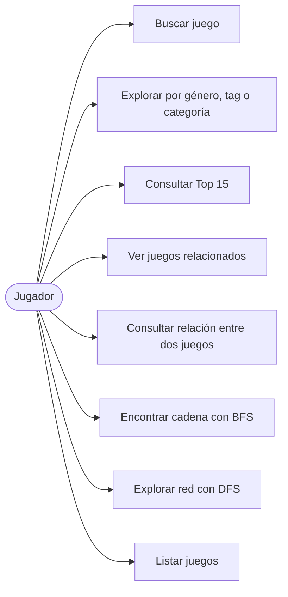

# Casos de uso — Pixperience

## Ver juegos relacionados (RF01)

El jugador ingresa un título. El sistema muestra hasta 10 juegos relacionados,
ordenados por similitud y rating. Si el título no existe o no tiene relacionados,
lo informa.

## Buscar juego (RF02)

El jugador ingresa un título; el sistema muestra su ficha. La búsqueda usa el AVL y
no distingue mayúsculas. Si no existe, lo informa.

## Top 15 (RF03)

El sistema muestra hasta 15 juegos ordenados por rating descendente; si hay menos,
muestra los disponibles.

## Explorar juegos (RF04)

El jugador filtra por género o tag, o explora una categoría y sus subcategorías.

## Relaciones entre juegos (RF05)

Las opciones de terminal permiten ver los relacionados de un juego, consultar la
relación directa entre dos títulos o hallar una cadena con menos aristas mediante BFS.
DFS recorre los juegos alcanzables desde un título.

