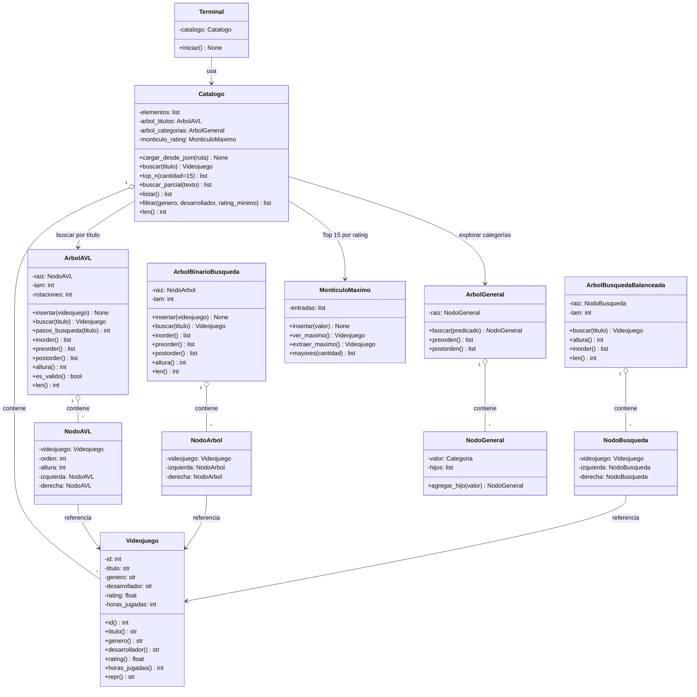

# Diagrama de clases

> Actualizado en TP6: búsqueda AVL, jerarquía de categorías y ranking mediante montículo.
> Se conservan el BST de TP3 y el árbol estático experimental de TP2.

> **Nota:** `Catalogo.buscar()` delega en `ArbolAVL.buscar()`. `Catalogo.top_n()` consulta
> el montículo construido al cargar el catálogo; `mayores()` no altera su contenido.
> `ArbolBinarioBusqueda` ya no
> está en producción: queda como punto de comparación de `benchmark_tp4.py`. La búsqueda
> secuencial (`algoritmos/busqueda_secuencial.py`) se conserva para la comparación. El
> `ArbolBusquedaBalanceada` sigue aislado en el experimento TP2 y no se reutiliza: la
> nueva estructura se construye insertando cada juego en el orden de carga.

## Diferencias respecto del diagrama inicial (TP0)

- La clase de dominio se llama `Videojuego` (en TP0 figuraba como `Juego`).
- `Videojuego` todavía no tiene el atributo `tags`; se mantiene pendiente para ampliar
  RF04 y RF05.
- `ArbolGeneral` se integró en TP5 y `MonticuloMaximo` en TP6. El grafo y el
  `Recomendador` se incorporan en etapas posteriores. Ver `04-diagrama-datos.md`.
- Se agregaron `Catalogo` y `Terminal`, que en TP0 no estaban diagramadas.
- TP2 agregó `ArbolBusquedaBalanceada` y `NodoBusqueda`, exclusivas del experimento de
  comparación de estrategias de búsqueda; no reemplazan al BST que se construye en TP3.
