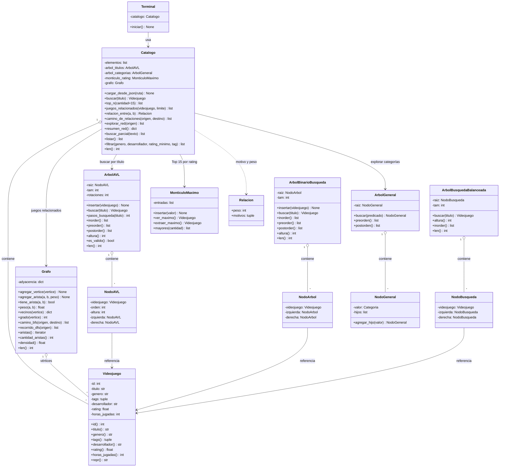

# Diagrama de clases

> Actualizado en TP8: búsqueda AVL, categorías, ranking, grafo y recorridos BFS/DFS.
> Se conservan el BST de TP3 y el árbol estático experimental de TP2.

> **Nota:** `Catalogo.buscar()` delega en `ArbolAVL.buscar()`. `Catalogo.top_n()` consulta
> el montículo construido al cargar el catálogo; `mayores()` no altera su contenido.
> `Catalogo` construye el `Grafo` al cargar los datos (`servicios/relaciones.py` define el
> criterio de similitud y la clase `Relacion`) y lo consulta en `juegos_relacionados()` y
> `relacion_entre()`.
> `ArbolBinarioBusqueda` ya no
> está en producción: queda como punto de comparación de `benchmark_tp4.py`. La búsqueda
> secuencial (`algoritmos/busqueda_secuencial.py`) se conserva para la comparación. El
> `ArbolBusquedaBalanceada` sigue aislado en el experimento TP2 y no se reutiliza: la
> nueva estructura se construye insertando cada juego en el orden de carga.

## Diferencias respecto del diagrama inicial (TP0)

- La clase de dominio se llama `Videojuego` (en TP0 figuraba como `Juego`).
- `Videojuego` incorpora `tags` en TP7 para ampliar RF04 y RF05.
- `ArbolGeneral` se integró en TP5, `MonticuloMaximo` en TP6 y `Grafo` en TP7. El
  `Recomendador` se incorpora en etapas posteriores. Ver `04_diagrama_datos.md`.
- Se agregaron `Catalogo` y `Terminal`, que en TP0 no estaban diagramadas.
- TP2 agregó `ArbolBusquedaBalanceada` y `NodoBusqueda`, exclusivas del experimento de
  comparación de estrategias de búsqueda; no reemplazan al BST que se construye en TP3.
