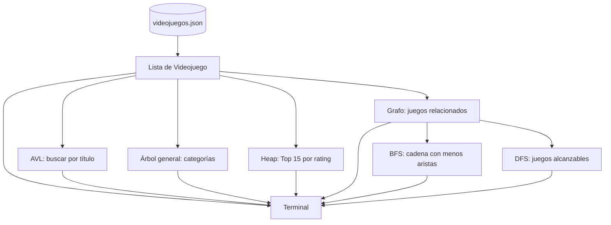

# Diagrama de conexión entre estructuras

## Estado actual

El catálogo conserva la lista de videojuegos para listar y filtrar. Al cargar el JSON,
construye el AVL de búsqueda, el árbol de categorías, el montículo de rating y el grafo
de relaciones.

`Catalogo` ofrece búsqueda exacta con AVL; si no hay coincidencia, la terminal presenta
coincidencias parciales de título. Filtrar y listar recorren la lista. El Top-N cuesta
O(k log k). Las consultas BFS y DFS recorren el grafo en O(V + E).

El BST de TP3 y el árbol balanceado de TP2 se mantienen para sus experimentos; la
aplicación usa AVL para buscar títulos.

