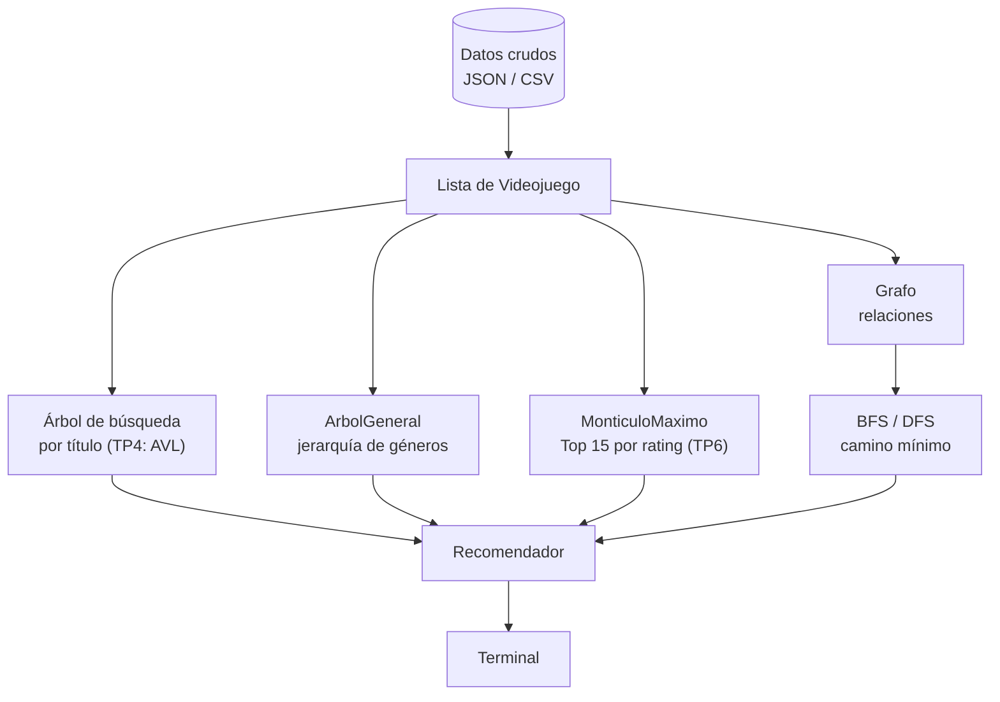

# Diagrama de conexión entre estructuras

## Estado actual (TP7)

La carga conserva una lista para listar y filtrar. Para buscar por título, `Catalogo`
mantiene un AVL construido por inserción en el orden de los datos; se autobalancea,
por lo que mantiene altura O(log n) con cualquier orden de carga, aunque la altura
exacta puede variar. El árbol general organiza las familias y categorías. El
montículo máximo se construye al cargar los datos y mantiene el ranking por rating.
El grafo de relaciones conecta juegos que comparten género, familia o desarrollador.
El BST de TP3 y el árbol estático de TP2 quedan como referencia experimental.

```mermaid
flowchart TD
    A[("datos/videojuegos.json<br/>datos crudos")] -->|cargar_desde_json| B["list[Videojuego]<br/>Catalogo._elementos"]

    subgraph prod["Producción (Terminal v5)"]
        B -->|insertar en orden de carga| C["ArbolAVL"]
        C -->|"buscar por título - O(log n) garantizado"| D["Catalogo.buscar()"]
        B -->|"recorrido O(n)"| E["buscar_parcial / filtrar"]
        B -->|copia de la lista| F["listar"]
        B -->|heapify O(n), prioridad rating| P["MonticuloMaximo"]
        P -->|"Top k: O(k log k), sin mutar el heap"| Q["Catalogo.top_n(15)"]
        B -->|agrupación por familia y género| R["ArbolGeneral de categorías"]
        B -->|"comparar pares O(n²), peso por similitud"| S["Grafo no dirigido y pesado"]
        S -->|"vecinos O(d log d), relación O(1)"| T["juegos_relacionados / relacion_entre"]
    end

    D --> G["Terminal v5"]
    E --> G
    F --> G
    Q --> G
    R --> G
    T --> G

    subgraph exp["Comparación experimental"]
        B -.->|sufijos únicos| H["dataset TP3 sintético"]
        H -->|"buscar_secuencial - O(n)"| I["benchmark_tp3.py"]
        H -->|"BST dinámico - O(h)"| I
        I --> J["resultados_tp3.csv<br/>tp3-complejidad.md"]
        H -.->|5 órdenes de inserción| M["benchmark_tp4.py"]
        M -->|BST vs AVL| N["resultados_tp4.csv<br/>tp4-avl.md"]
        H -.->|ordenar + partir al medio| K["ArbolBusquedaBalanceada TP2"]
        K -->|"O(log n) en ese experimento"| L["benchmark_tp2.py"]
    end
```

**Estructuras en producción:** una lista de objetos `Videojuego`, un AVL por título,
un árbol general de categorías, un montículo máximo por rating y un grafo de relaciones. La búsqueda cuesta
O(log n) en el peor caso, también cuando los datos llegan ordenados (el BST de TP3 caía
a O(n) en ese caso). El heapify cuesta O(n) al cargar; luego, obtener los primeros k
juegos cuesta O(k log k), sin mutar ni copiar el catálogo. Listar, filtrar y buscar texto
parcial conservan sus recorridos lineales sobre la lista.

**Estructura del experimento de TP2:** `ArbolBusquedaBalanceada`, construido ordenando
los datos y particionando por el elemento medio. Mantiene altura O(log n) por
construcción, pero no está conectado a la aplicación. El AVL de producción no la
reutiliza: mantiene una altura O(log n) de forma incremental, aunque no siempre
la mínima posible, sin reconstruir al insertar.

## Diagrama objetivo (producto final)



## Evolución prevista

| Etapa | Estructura | Requerimiento | Por qué esta estructura |
|-------|------------|----------------|---------------------------|
| TP2 | `buscar_secuencial` vs. `ArbolBusquedaBalanceada` (experimental) | RF02 | Medir el costo real de la búsqueda lineal y compararlo contra una estructura logarítmica, antes de comprometerse a integrar una. |
| TP3 | BST dinámico por título, construido por inserción | RF02 | Integra la búsqueda al producto y permite observar cómo el orden de inserción afecta la altura y el costo. |
| TP4 | `ArbolAVL<Videojuego>` | RF02 | Búsqueda por título en tiempo logarítmico garantizado; el balance automático evita que degenere en lista si el dataset viene ordenado alfabéticamente. |
| TP5 | `ArbolGeneral<Categoria>` | RF04 | Navegar familias y géneros; los juegos se agrupan en las hojas de la jerarquía. |
| TP6 | `MonticuloMaximo<Videojuego>` | RF03 | Consultar los juegos con mayor rating sin ordenar todo el catálogo en cada consulta. |
| TP7 | `Grafo<Videojuego>` | RF01, RF05 | Juegos como nodos; aristas precalculadas según género, familia y desarrollador compartidos (los tags siguen pendientes), para no comparar contra todo el catálogo en cada consulta. Ver `tp7-grafo.md`. |
| TP8 | BFS / DFS | RF01, RF05 | Explorar la red de relaciones. |
| TP9 | Camino mínimo | A definir | Se define qué significa "costo" entre dos juegos. |
