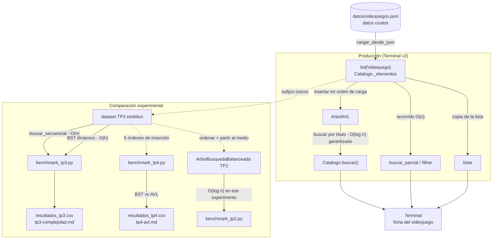
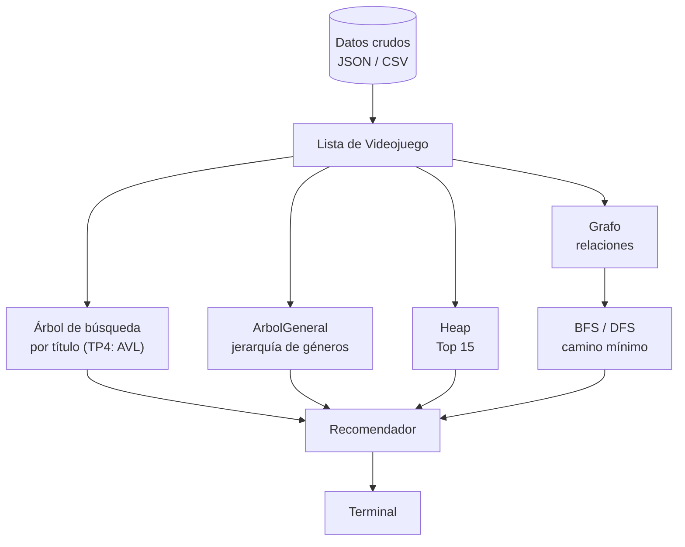

# Diagrama de conexión entre estructuras

## Estado actual (TP4)

La carga conserva una lista para listar y filtrar. Para buscar por título, `Catalogo`
mantiene un AVL construido por inserción en el orden de los datos; se autobalancea,
por lo que mantiene altura O(log n) con cualquier orden de carga, aunque la altura
exacta puede variar. El BST de TP3 y el árbol estático de TP2 quedan como
referencia experimental.

**Estructuras en producción:** una lista de objetos `Videojuego` y un AVL por título.
La búsqueda cuesta O(log n) en el peor caso, también cuando los datos llegan ordenados
(el BST de TP3 caía a O(n) en ese caso). Listar, filtrar y buscar texto parcial conservan sus
recorridos lineales sobre la lista.

**Estructura del experimento de TP2:** `ArbolBusquedaBalanceada`, construido ordenando
los datos y particionando por el elemento medio. Mantiene altura O(log n) por
reutiliza: mantiene una altura O(log n) de forma incremental, aunque no siempre
la mínima posible, sin reconstruir al insertar.
reutiliza: logra la misma altura de forma incremental, sin reconstruir al insertar.

## Diagrama objetivo (producto final)

## Evolución prevista

| Etapa | Estructura | Requerimiento | Por qué esta estructura |
|-------|------------|----------------|---------------------------|
| TP2 | `buscar_secuencial` vs. `ArbolBusquedaBalanceada` (experimental) | RF02 | Medir el costo real de la búsqueda lineal y compararlo contra una estructura logarítmica, antes de comprometerse a integrar una. |
| TP3 | BST dinámico por título, construido por inserción | RF02 | Integra la búsqueda al producto y permite observar cómo el orden de inserción afecta la altura y el costo. |
| TP4 | `ArbolAVL<Videojuego>` | RF02 | Búsqueda por título en tiempo logarítmico garantizado; el balance automático evita que degenere en lista si el dataset viene ordenado alfabéticamente. |
| TP5 | `ArbolGeneral<Videojuego>` | RF04 | Navegar una jerarquía de géneros y subgéneros, algo que un árbol binario no soporta. |
| TP6 | `Heap<Videojuego>` | RF03 | Extraer repetidamente el juego de mayor puntaje sin ordenar todo el catálogo cada vez. |
| TP7 | `Grafo<Videojuego>` | RF01, RF05 | Juegos como nodos; aristas precalculadas según género, tags y desarrollador compartidos, para no comparar contra todo el catálogo en cada consulta. |
| TP8 | BFS / DFS | RF01, RF05 | Explorar la red de relaciones. |
| TP9 | Camino mínimo | A definir | Se define qué significa "costo" entre dos juegos. |
